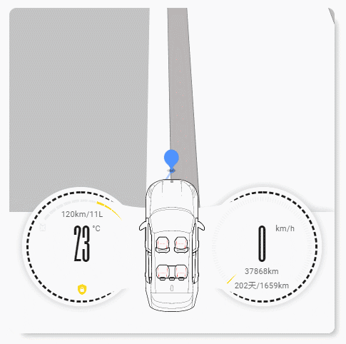

# Lovelace Car Card v2.0

[English](README_EN.MD) | **中文**

[](https://github.com/custom-components/hacs)

这是适用于 Lovelace 的汽车仪表盘卡片，详细展示车辆的各种状态，以及车辆远程控制的一些交互。

现在可以适配任何汽车集成。目前测试兼容的集成有：

- [byd_china](https://github.com/qq458249269/byd_china)
- [hass-byd-vehicle](https://github.com/jkaberg/hass-byd-vehicle)

所有数据均可通过 UI 编辑器绑定到任意传感器实体，不再依赖特定集成的数据结构。

## 更新

### v2.0

- 适配任何汽车集成，不再依赖特定集成的数据结构
- 所有数据通过 UI 编辑器绑定到任意传感器实体
- 7 个状态图标支持自定义传感器（状态为 `异常` / `已解锁` 时点亮）
- 左右仪表盘主值、子传感器、能耗值/百分比均可单独绑定传感器（raw 值 + 单位）
- 车辆状态传感器驱动仪表盘发光（ON / OFF）
- 更新数据 / GPS 刷新按钮实体，单卡片显示时自动按下

### v1.0

- 支持面板模式
  
## 预览


## HACS 安装
搜索Car Card, 或者手动添加地址安装
## 手动安装
1. 下载 `car-card.js`
1. 复制到 `www\community\lovelace-car-card`
1. 在Lovelace的resources下添加以下配置
    ``` yaml
    resources:
      - url: /local/community/lovelace-car-card/car-card.js
        type: module
    ```
1. 在Lovelace视图 `views.cards` 内部添加卡片配置
    ```yaml
      type: 'custom:car-card'
      entity: device_tracker.lykco01
      key: 高德地图API_KEY
      traffic: true
      default_zoom: 20
      hours_to_show: '12'
    ```

## 选项

| 属性名 | 类型 | 默认 | 描述
| ---- | ---- | ------- | -----------
| entity | entity id | **必选** | 汽车集成提供的 device_tracker（车辆定位）
| default_zoom | Number | 选项 | 地图默认缩放等级
| traffic | boolean | 选项 | 实时路况
| hours_to_show | Number | 选项 | 指定时间内的历史路径,这里是填的是小时
| key | string | **必选** | 自己去高德申请key,内置的key说不定哪天就失效了.

## 车辆参数传感器

卡片中的每个车辆参数都可以在 **UI 编辑器 → 车辆参数（选择传感器）** 中单独选择一个传感器实体。
未选择传感器的参数使用默认值（见下方参数表）。
参数值为数值时自动转为数字，`on/off`、`true/false`、`1/0` 会自动转为布尔值。

### 状态传感器 (status_sensors)

仪表盘上 7 个状态图标的坑位固定不变。可以在 **UI 编辑器 → 状态传感器** 中选择 1~7 个传感器实体，
图标自动使用传感器自身的图标（优先取实体 `attributes.icon`，其次实体注册表图标），
传感器状态只有为 `异常` 或 `已解锁` 时才点亮（active），其余状态一律不点亮（inactive）。

选择/配置顺序即排列顺序，从中间向两侧展开：
底部正中 → 左下 → 右下 → 左 → 右 → 左中 → 右中。

```yaml
type: 'custom:car-card'
entity: device_tracker.lykco01
status_sensors:
  - binary_sensor.lykco_locked      # 底部正中
  - binary_sensor.engine_oil        # 左下
  - binary_sensor.brake_fluid       # 右下
  - binary_sensor.tyre_pressure     # 左
  - binary_sensor.light_fault       # 右
  - binary_sensor.washer_fluid      # 左中
  - binary_sensor.engine_coolant    # 右中
```

右仪表盘的主值可在 **UI 编辑器 → 右主传感器** 中选择实体（或 YAML 中配置 `right_main_sensor`）：
主值文本显示该传感器的 raw 状态，单位文本显示该传感器的 `unit_of_measurement` 属性：

```yaml
right_main_sensor: sensor.lykco_speed
```

右仪表盘下方的两个文本也可分别指定传感器（文本为 raw 值 + 单位）：
文本前会显示图标，优先使用传感器自身的图标（`attributes.icon` → 实体注册表图标），
未配置传感器时显示默认图标（第一子传感器 `mdi:counter`，第二子传感器 `mdi:wrench`）。

```yaml
sub_sensor_1: sensor.lykco_odometer   # 第一子传感器 (总里程文本)
sub_sensor_2: sensor.lykco_service    # 第二子传感器 (保养文本)
```

仪表盘的发光效果由车辆状态传感器驱动（`on` / `running` / `true` / `1` / `启动` / `运行中` 视为启动，
其余视为熄火），可在 **UI 编辑器 → 其他配置 → 车辆状态传感器** 中选择实体：

```yaml
vehicle_status_sensor: binary_sensor.lykco_engine
```

未配置时不启用发光效果。

如果数据源需要手动刷新，可在 **UI 编辑器 → 其他配置 → 更新数据按钮实体** 中选择一个按钮实体
（`button` / `input_button`），卡片以单卡片形式显示时会在加载后自动按下该按钮，以便及时更新数据：

```yaml
update_button: button.lykco_refresh
```

GPS 定位刷新按钮同理，配置后单卡片显示时也会自动按下：

```yaml
gps_update_button: button.lykco_refresh_gps
```

面板模式或未配置时不自动按下。

左仪表盘的主值可在 **UI 编辑器 → 左主传感器** 中选择实体（或 YAML 中配置 `left_main_sensor`），
主值文本显示 raw 状态，单位文本显示 `unit_of_measurement`：

```yaml
left_main_sensor: sensor.lykco_outside_temp
```

左仪表盘顶部的 `能耗值/百分比` 文本由两个传感器组成（用 `/` 分隔，文本为 raw 值 + 单位）：

```yaml
energy_value_sensor: sensor.lykco_range      # 能耗值, 例如 680km
energy_percent_sensor: sensor.lykco_battery  # 能耗百分比, 单位必须为 %, 例如 68%
```

配置了 `energy_percent_sensor` 时，能耗液位条（energyLevelStatus）按该百分比点亮（每 10% 亮一格）。

如果传感器状态恰好相反（例如车门传感器状态为 `已锁定` 才需要提醒），可以给该项加 `invert: true`，
此时点亮条件取反，状态为 `正常` / `已锁定` 时高亮：

```yaml
status_sensors:
  - entity: binary_sensor.lykco_locked
    invert: true
  - binary_sensor.engine_oil
```

> 提示：UI 编辑器中的多实体选择需要较新的 Home Assistant 版本，旧版本可直接在 YAML 中配置 `status_sensors`。
> 未配置 `status_sensors` 时，7 个状态图标不显示。

| 参数键 | 描述 | 数据来源
| ---- | ---- | ----
| right_main_sensor | 右主传感器（raw 值 + 单位） | 实体 state / unit_of_measurement
| left_main_sensor | 左主传感器（raw 值 + 单位） | 实体 state / unit_of_measurement
| sub_sensor_1 | 第一子传感器（raw 值 + 单位） | 实体 state / unit_of_measurement
| sub_sensor_2 | 第二子传感器（raw 值 + 单位） | 实体 state / unit_of_measurement
| energy_value_sensor | 能耗值传感器（raw 值 + 单位） | 实体 state / unit_of_measurement
| energy_percent_sensor | 能耗百分比传感器（单位必须为 %） | 实体 state / unit_of_measurement
| left_front_door | 左前车门 | 实体 state（未配置时默认 false）
| left_rear_door | 左后车门 | 实体 state（未配置时默认 false）
| right_front_door | 右前车门 | 实体 state（未配置时默认 false）
| right_rear_door | 右后车门 | 实体 state（未配置时默认 false）
| left_front_door_lock | 左前门锁 | 实体 state（未配置时默认 true）
| left_rear_door_lock | 左后门锁 | 实体 state（未配置时默认 true）
| right_front_door_lock | 右前门锁 | 实体 state（未配置时默认 true）
| right_rear_door_lock | 右后门锁 | 实体 state（未配置时默认 true）
| left_front_window | 左前车窗状态 | 实体 state（未配置时默认 2）
| left_rear_window | 左后车窗状态 | 实体 state（未配置时默认 2）
| right_front_window | 右前车窗状态 | 实体 state（未配置时默认 2）
| right_rear_window | 右后车窗状态 | 实体 state（未配置时默认 2）
| sunroof_status | 天窗状态 | 实体 state（未配置时默认 1）
| engine_hood_status | 引擎盖状态 | 实体 state（未配置时默认 0）
| trunk_status | 后备箱状态 | 实体 state（未配置时默认 0）
| left_front_seat_belt | 左前安全带 | 实体 state（未配置时默认 true）
| left_rear_seat_belt | 左后安全带 | 实体 state（未配置时默认 true）
| right_front_seat_belt | 右前安全带 | 实体 state（未配置时默认 true）
| right_rear_seat_belt | 右后安全带 | 实体 state（未配置时默认 true）
| left_front_tyre_warning | 左前轮胎报警 | 实体 state（未配置时默认 false）
| left_rear_tyre_warning | 左后轮胎报警 | 实体 state（未配置时默认 false）
| right_front_tyre_warning | 右前轮胎报警 | 实体 state（未配置时默认 false）
| right_rear_tyre_warning | 右后轮胎报警 | 实体 state（未配置时默认 false）
| direction | 行驶方向 (°) | 实体 state（未配置时默认 0）
| vehicle_status_sensor | 车辆状态传感器（ON/OFF 驱动仪表盘发光） | 实体 state（未配置时不发光）
| update_button | 更新数据按钮实体（单卡片显示时自动按下） | 实体 state（未配置时不自动按下）
| gps_update_button | GPS定位刷新按钮实体（单卡片显示时自动按下） | 实体 state（未配置时不自动按下）
