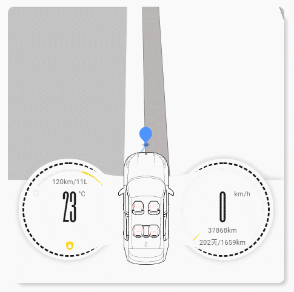

# Lovelace Car Card v2.0

[中文](README.MD) | **English**

[](https://github.com/custom-components/hacs)

A Lovelace dashboard card for your car. It shows the vehicle status in detail and provides some remote-control interactions.

Works with any car integration. Tested and compatible integrations:

- [byd_china](https://github.com/qq458249269/byd_china)
- [hass-byd-vehicle](https://github.com/jkaberg/hass-byd-vehicle)

All data can be bound to any sensor entity via the UI editor. No dependency on a specific integration's data structure.

## Changelog

### v2.0

- Works with any car integration
- All data is bound to sensor entities via the UI editor
- 7 status icons with custom sensors (activated on `异常` / `已解锁`)
- Left/right gauge main values, sub sensors and energy value/percent can be bound to sensors (raw value + unit)
- Vehicle status sensor drives the gauge glow (ON / OFF)
- Refresh data / GPS refresh button entities, auto-pressed in card view

### v1.0

- Panel mode support

## Preview



## Install via HACS

Search for "Car Card", or add the repository manually.

## Manual install

1. Download `car-card.js`
1. Copy it to `www\community\lovelace-car-card`
1. Add the resource in Lovelace:
    ```yaml
    resources:
      - url: /local/community/lovelace-car-card/car-card.js
        type: module
    ```
1. Add the card in `views.cards`:
    ```yaml
      type: 'custom:car-card'
      entity: device_tracker.lykco01
      key: YOUR_AMAP_API_KEY
      traffic: true
      default_zoom: 20
      hours_to_show: '12'
    ```

## Options

| Name | Type | Default | Description
| ---- | ---- | ------- | -----------
| entity | entity id | **required** | device_tracker from your car integration (vehicle location)
| default_zoom | Number | optional | Default map zoom level
| traffic | boolean | optional | Real-time traffic
| hours_to_show | Number | optional | Hours of history path to show
| key | string | **required** | Apply for your own AMap key

## Vehicle parameter sensors

Every vehicle parameter can be bound to a sensor entity in **UI editor → Vehicle parameters**.
If no sensor is selected, the default value is used (see the parameter table below).
Numeric values are converted to numbers; `on/off`, `true/false`, `1/0` are converted to booleans.

### Status sensors (status_sensors)

The 7 status icon slots on the dashboard are fixed. In **UI editor → Status sensors** you can select 1~7 sensor
entities. Each icon uses the sensor's own icon (`attributes.icon` first, then the entity registry icon).
The icon lights up (active) only when the state is `异常` (abnormal) or `已解锁` (unlocked); all other states are inactive.

The order of selection is the order of placement, from center outward:
bottom-center → bottom-left → bottom-right → left → right → center-left → center-right.

```yaml
type: 'custom:car-card'
entity: device_tracker.lykco01
status_sensors:
  - binary_sensor.lykco_locked      # bottom-center
  - binary_sensor.engine_oil        # bottom-left
  - binary_sensor.brake_fluid       # bottom-right
  - binary_sensor.tyre_pressure     # left
  - binary_sensor.light_fault       # right
  - binary_sensor.washer_fluid      # center-left
  - binary_sensor.engine_coolant    # center-right
```

The right gauge main value can be set in **UI editor → Right gauge main sensor**
(or with `right_main_sensor` in YAML). The main text shows the sensor's raw state, and the unit text shows
its `unit_of_measurement`:

```yaml
right_main_sensor: sensor.lykco_speed
```

The two texts below the right gauge can also be bound to sensors (raw value + unit).
An icon is shown before each text, using the sensor's own icon (`attributes.icon` → entity registry icon);
if not configured, default icons are shown (`mdi:counter` for sub sensor 1, `mdi:wrench` for sub sensor 2).

```yaml
sub_sensor_1: sensor.lykco_odometer   # sub sensor 1 (odometer text)
sub_sensor_2: sensor.lykco_service    # sub sensor 2 (service text)
```

The gauge glow is driven by the vehicle status sensor (`on` / `running` / `true` / `1` / `启动` / `运行中`
are treated as ON, everything else as OFF). Set it in **UI editor → Other → Vehicle status sensor**:

```yaml
vehicle_status_sensor: binary_sensor.lykco_engine
```

No glow when not configured.

If your data source needs a manual refresh, select a button entity (`button` / `input_button`) in
**UI editor → Other → Refresh data button**. When the card is shown as a single card, the button is
auto-pressed after load to update the data:

```yaml
update_button: button.lykco_refresh
```

The GPS refresh button works the same way:

```yaml
gps_update_button: button.lykco_refresh_gps
```

No auto-press in panel mode or when not configured.

The left gauge main value can be set in **UI editor → Left gauge main sensor**
(or with `left_main_sensor` in YAML). The main text shows the raw state, the unit text shows `unit_of_measurement`:

```yaml
left_main_sensor: sensor.lykco_outside_temp
```

The `energy value/percent` text at the top of the left gauge is made of two sensors (separated by `/`,
each text is raw value + unit):

```yaml
energy_value_sensor: sensor.lykco_range      # energy value, e.g. 680km
energy_percent_sensor: sensor.lykco_battery  # energy percent, unit must be %, e.g. 68%
```

When `energy_percent_sensor` is set, the energy level bar (energyLevelStatus) lights up by percentage
(one segment per 10%).

If the sensor state is inverted (e.g. a door sensor that should alert when `已锁定`), add `invert: true`;
the light-up condition is then inverted (`正常` / `已锁定` lights up):

```yaml
status_sensors:
  - entity: binary_sensor.lykco_locked
    invert: true
  - binary_sensor.engine_oil
```

> Note: multi-entity selection in the UI editor requires a recent Home Assistant version. Older versions
> can configure `status_sensors` directly in YAML.
> If `status_sensors` is not configured, the 7 status icons are hidden.

## Parameter table

| Key | Description | Data source
| ---- | ---- | ----
| right_main_sensor | Right gauge main sensor (raw value + unit) | entity state / unit_of_measurement
| left_main_sensor | Left gauge main sensor (raw value + unit) | entity state / unit_of_measurement
| sub_sensor_1 | Sub sensor 1 (raw value + unit) | entity state / unit_of_measurement
| sub_sensor_2 | Sub sensor 2 (raw value + unit) | entity state / unit_of_measurement
| energy_value_sensor | Energy value sensor (raw value + unit) | entity state / unit_of_measurement
| energy_percent_sensor | Energy percent sensor (unit must be %) | entity state / unit_of_measurement
| left_front_door | Front left door | entity state (default false)
| left_rear_door | Rear left door | entity state (default false)
| right_front_door | Front right door | entity state (default false)
| right_rear_door | Rear right door | entity state (default false)
| left_front_door_lock | Front left door lock | entity state (default true)
| left_rear_door_lock | Rear left door lock | entity state (default true)
| right_front_door_lock | Front right door lock | entity state (default true)
| right_rear_door_lock | Rear right door lock | entity state (default true)
| left_front_window | Front left window | entity state (default 2)
| left_rear_window | Rear left window | entity state (default 2)
| right_front_window | Front right window | entity state (default 2)
| right_rear_window | Rear right window | entity state (default 2)
| sunroof_status | Sunroof | entity state (default 1)
| engine_hood_status | Engine hood | entity state (default 0)
| trunk_status | Trunk | entity state (default 0)
| left_front_seat_belt | Front left seat belt | entity state (default true)
| left_rear_seat_belt | Rear left seat belt | entity state (default true)
| right_front_seat_belt | Front right seat belt | entity state (default true)
| right_rear_seat_belt | Rear right seat belt | entity state (default true)
| left_front_tyre_warning | Front left tire warning | entity state (default false)
| left_rear_tyre_warning | Rear left tire warning | entity state (default false)
| right_front_tyre_warning | Front right tire warning | entity state (default false)
| right_rear_tyre_warning | Rear right tire warning | entity state (default false)
| direction | Heading (°) | entity state (default 0)
| vehicle_status_sensor | Vehicle status sensor (ON/OFF drives gauge glow) | entity state (no glow when unset)
| update_button | Refresh data button entity (auto press in card view) | entity state (no auto press when unset)
| gps_update_button | GPS refresh button entity (auto press in card view) | entity state (no auto press when unset)
